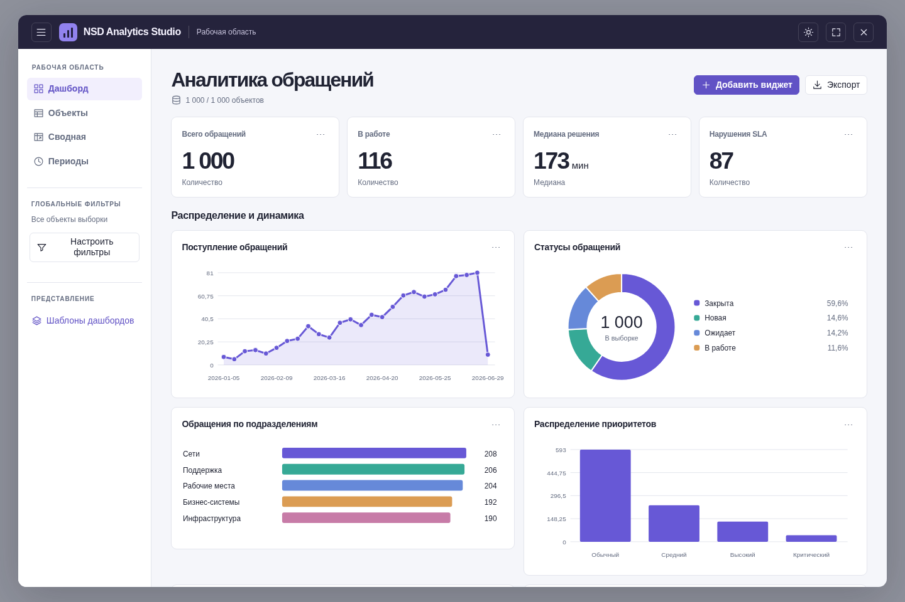
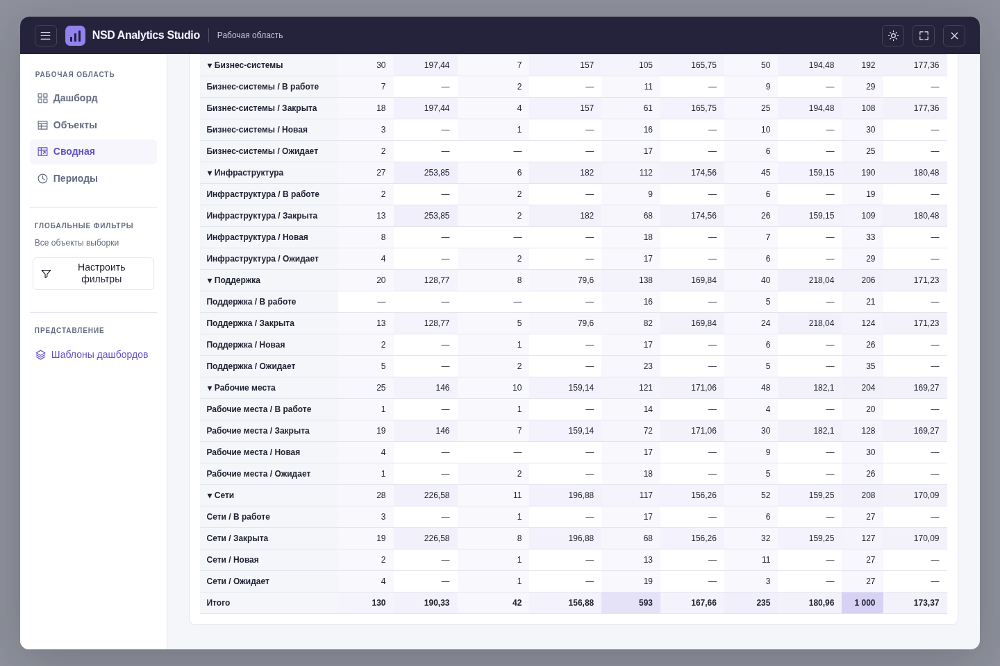

# NSD Analytics Studio

Автономная BI-панель для Naumen Service Desk. Groovy готовит разрешённый снимок объектов, браузер строит по нему дашборды и сводные таблицы. После открытия фильтры, детализация, статистика и выгрузки работают локально. Аналитическое ядро подходит для заявок, сотрудников, оборудования и произвольных классов.



## Подключение в NSD через каталог кастомизации

Сборка `dist/nsd-analytics-customization.js` не подписана. Если каталог выдаёт «Ошибка проверки подписи», для установки в него требуется файл с подписью, которую принимает стенд. Уточните в поддержке NAUMEN порядок согласования файла для вашей сборки. [Что делать при ошибке подписи](docs/customization.md)

## Локальное демо и подключение через JavaScript

1. Скачайте архив релиза или исходников и распакуйте его.
2. Откройте **demo/index.html**. Появится дашборд на 1 000 синтетических обращений. Нажмите на сегмент кольца и выберите «Показать исходные объекты». Закройте окно Studio, чтобы выбрать другой набор или объём.
3. Для своего веб-интерфейса загрузите **dist/nsd-analytics.min.js** с локального ресурса. Вызовите NSDAnalytics.open с переданным массивом. Вместо минифицированного файла можно выбрать читаемый dist/nsd-analytics.js. В каждом файле уже есть весь runtime, CSS и Worker.

```html
<script src="./dist/nsd-analytics.min.js"></script>
<script>
  const rows = [
    {uuid:'demo$1', status:'В работе', duration:120},
    {uuid:'demo$2', status:'Закрыта', duration:45}
  ];
  NSDAnalytics.open(rows, {
    title:'Время решения',
    columns:[
      {code:'uuid', title:'UUID'},
      {code:'status', title:'Статус', type:'string'},
      {code:'duration', title:'Время решения', type:'number', unit:'мин'}
    ]
  });
</script>
```

Этот пример содержит статические синтетические строки. Для серверного payload используйте аргумент зарегистрированного JS-обработчика. [Подключение к Naumen 4.17](docs/nsd-integration.md)

## Что можно сделать

| Работа аналитика | Реализация |
|---|---|
| Исследовать выборку | Настроить вложенные AND/OR, отрицательные условия, списки, даты, интервалы и заполненность. Из графика перейти на следующий уровень или к соответствующим объектам. |
| Сравнить показатели | COUNT, COUNT DISTINCT, SUM, AVG, MIN, MAX, MEDIAN, MODE, перцентили, дисперсия и стандартное отклонение. TOP/BOTTOM N, доли, накопление, отклонение и сравнение периодов. |
| Визуализировать | Два вида столбцов, круг, кольцо, линия, область, накопление, heatmap, scatter, гистограмма, treemap, воронка, KPI, Pareto, box plot, gauge, сводная и таблица объектов. |
| Собрать сводную | До трёх уровней строк и двух уровней столбцов, до четырёх мер, сворачивание групп, промежуточные/общие итоги, сортировка, цветовая шкала, экспорт и исходные объекты ячейки. |
| Настроить дашборд | Добавить или удалить виджет, изменить его тип, меру, порядок, ширину, высоту, детализацию, фильтр. Экспортировать/восстановить JSON-шаблон. Разрешённое локальное сохранение включается хостом. |
| Выгрузить результат | CSV, TSV, JSON, HTML, буфер обмена для Excel, печать. У SVG-диаграммы в меню доступны SVG и PNG. Настоящий XLSX в версию 0.1.0 не входит. |
| Анализировать крупный снимок | Пакетная подготовка, Worker с переходом в основной поток при необходимости, виртуализация объектов, кеш выборок, отмена при смене представления и при закрытии. |

## Готовые сценарии

**Заявки.** 14 виджетов показывают количество, статусы, приоритеты, сотрудников, подразделения, услуги, поступление и закрытие, среднее и медианное время решения, SLA, просрочку и возраст открытых заявок. Рабочие показатели SLA поступают с сервера.

**Сотрудники.** Активные и выполненные задачи, загрузка и её распределение, среднее время сотрудника и динамика по отчётным периодам. Сотрудники обозначены номерами, набор генерируется детерминированно.

**Оборудование.** Типы, производители, подразделения, состояние, возраст, приближение конца гарантии и связанные инциденты. Для нового класса можно передать только массив и затем настроить свои измерения и меры.



## Интеграция и документация

| Материал | Содержание |
|---|---|
| [Установка](docs/installation.md) | Демо без сервера, промышленный файл, сборка и команды проверок. |
| [Naumen и Groovy](docs/nsd-integration.md) | Граница прав, пакетная проекция, безопасная сериализация и точка привязки реального вызова JavaScript. |
| [Настройки](docs/configuration.md) | Типы и поля, обработка массивов, фильтры, виджеты, темы, локализация, карточки, встраивание. |
| [Публичный API](docs/api-reference.md) | open, update, close, destroy, exportConfig, importConfig. |
| [Формулы](docs/statistics.md) | Пустые значения, критерий выбросов, знаменатели, неаддитивные итоги и числовые ограничения. |
| [Архитектура](docs/architecture.md) · [Исследование](docs/research.md) | Движки, протокол запросов, решения и ссылки на первоисточники. |
| [Безопасность](docs/security.md) | Модель доверия, защита DOM, импорта, локальных настроек, ссылок и табличных выгрузок. |
| [Производительность и QA](docs/performance.md) | Реальные измерения для пяти размеров, результаты тестов, условия и ограничения. |
| [Тёмная тема](docs/screenshots/dark.png) · [Мобильный режим](docs/screenshots/mobile.png) | Снимки реально работающего приложения на синтетическом наборе. |

## Статус и дальнейшее развитие

Приложение проверено локально в Chromium, Groovy — отдельно на JVM. Испытаний в рабочей NSD 4.17 и на SQL Server не проводилось. Сигнатура запуска JavaScript и вызовы получения авторизованной выборки задаются корпоративной реализацией. В проекте нет обязательных REST/AJAX, подключения к БД, сетевой телеметрии, CDN или runtime-зависимостей.

Верхняя граница — 100 000 строк с дополнительными ограничениями на байты, глубину, число ячеек и вычислительную сложность. Практический предел зависит от ширины DTO и браузера. Диаграммы описывают переданный снимок; refresh выполняется явно через update. В 0.1.0 поля справочника и названия при локальном сохранении должны быть несекретными. Встроена русская локализация, поддерживаются внешние словари надписей и Intl.

Для следующего рабочего выпуска приоритетны приёмка на стенде 4.17 с двумя ролями, замеры запросов при пакетной проекции и проверка браузеров организации. Затем можно расширять набор календарных интервалов и перевод диагностических сообщений. [Лицензия MIT](LICENSE)
