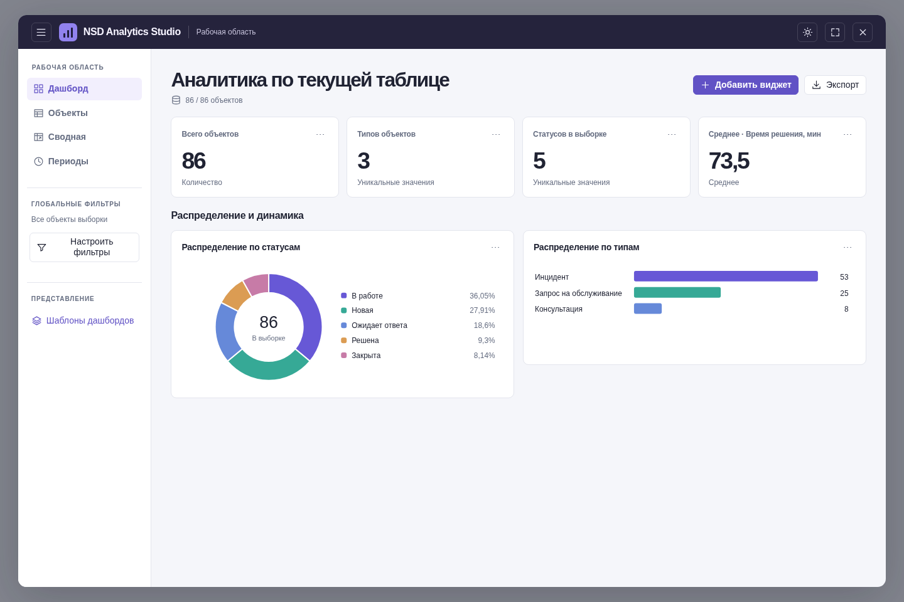

# Интерактивная Studio по кнопке таблицы

Оператор фильтрует таблицу и нажимает **Аналитика**. Поверх таблицы открывается исходный интерфейс Studio: KPI, кольцевая и столбчатая диаграммы, фильтры, сводная, исходные строки и экспорт. Данные поступают из текущего списка NSD.



## Что куда вставить

1. В интерфейсе администратора откройте **Настройка системы → Каталог скриптов и модулей → Каталог модулей → Добавить модуль**. Укажите код **nsdAnalyticsStudio**. В поле **Текст** вставьте целиком [nsdAnalyticsStudio.groovy](../groovy/table-studio/nsdAnalyticsStudio.groovy). Если есть флажок **Доступен для REST-запросов**, снимите его. Сохраните модуль. Внутри уже есть JavaScript и стили.
2. Откройте **Настройка системы → Действия по событиям** и существующее синхронное действие **Аналитика**. Сохраните копию прежнего тела действия. В поле **Скрипт** вставьте [TableButton.groovy](../groovy/table-studio/TableButton.groovy). Для новой кнопки выберите класс строк таблицы, событие **[Пользовательское событие]**, действие **Скрипт**, синхронное выполнение, затем включите действие.
3. У существующей кнопки проверьте **Применяется к → к объектам списка** и привязку к этому действию. Для нового списка откройте его настройки **Панель действий → Новая кнопка → Добавить на панель действий**, подпись **Аналитика**. В группе прав «Пользовательские события» назначьте право роли, которой доступны поля отчёта во всех строках этой выборки.

**Проверка.** Под оператором отфильтруйте таблицу до известного числа объектов. Нажмите **Аналитика**. Сверьте **Всего объектов** со счётчиком списка. Нажмите на сегмент кольца → **Показать исходные объекты**. Закройте Studio и проверьте, что вернулись в тот же список с его исходным фильтром.

## Что редактировать для своей таблицы

Редактируйте **TableButton.groovy**. В нём находится выборка `list`, подготовка обычных Map и названия колонок. По умолчанию передаются только тип и статус. Для среднего укажите код разрешённого числового атрибута в `def metric = ''` и при необходимости подпись в `metricTitle`. Модуль добавит среднее на дашборд. Чтобы передать другие поля, добавьте доступное значение в `row` и описание в `columns`. Даты передаются в миллисекундах Unix с типом `date`, ссылки — как разрешённые текстовые представления. Автоматического чтения всех атрибутов или столбцов экрана нет. При правах, отличающихся по строкам, примените серверные правила на строку и поле перед заполнением `row`.

Последняя операция передаёт массив строк и конфигурацию в модуль:

```groovy
result.executeJavaScript(modules.nsdAnalyticsStudio.open(rows, settings))
```

Чтобы переопределить начальное представление, можно задать `settings.widgets` и `settings.pivot` по [контракту Studio](configuration.md). Флажки строк не меняют выборку этой кнопки. Для усечённого списка (`list.limitExceeded()`, предел 1000) действие предлагает сузить фильтр. Дополнительный бюджет сериализованных данных с настройками — 2 МиБ.

## Среда

Модуль использует тот же компонент Studio, что автономная сборка, и открывает его в изолированном фрейме штатного клиентского действия. Фрейм имеет отдельный источник, запрет сетевых запросов и отдельную политику CSP с хешем кода. Для просмотра и экспорта исходящие запросы не выполняются. Импорт и экспорт шаблонов работают с файлами. Для печати сохраните HTML и распечатайте его в браузере. При ограничении буфера обмена используйте TSV. Если политика стенда запрещает локальные фреймы или выполнение вложенного скрипта, появится сообщение с кнопкой закрытия. Этот случай требует проверки поддерживаемого способа установки с администратором стенда.

Проверены Groovy 2.4.21 и Chromium на имитации события. На реальной NSD 4.17 модуль и права необходимо проверить под тестовым оператором. [Каталог модулей Naumen](https://www.naumen.ru/docs/sd/nsmp/Content/script/modul_catalog.htm) · [Методы модулей](https://www.naumen.ru/docs/sd/nsmp/Content/script/modul.htm) · [Методы результата действия](https://www.naumen.ru/docs/sd/nsmp/Content/script/api_scr_user.htm)
